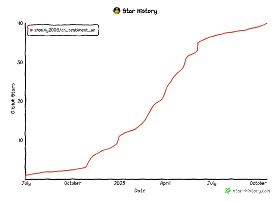

# BERT-based Chinese Sentiment Classification Task

<p align="center">
  <a href="https://github.com/google-research/bert">
    
  </a>
    <a href="https://github.com/huggingface/transformers">
    
  </a>
</p>

This document introduces how to implement a sentiment analysis task using the `transformers` library and related tools. The scripts are based on the pretrained BERT model (`bert-base-chinese`) and classify text into three sentiment categories: positive, negative, and neutral.

---
- `cn_sentiment.py` is the training script
- `tag.py` is the testing script

## 1. **Environment Dependencies**

Before running the code, make sure the following Python libraries are installed:

- `transformers`
- `datasets`
- `pandas`
- `numpy`
- `seaborn`
- `matplotlib`
- `scikit-learn`
- `torch`

You can install the dependencies using the following command:

```bash
pip install transformers datasets pandas numpy seaborn matplotlib scikit-learn torch
```

---

## 2. **Script Workflow**

### **Step 1: Load and Process the Data**
1. **Read the Input CSV File**  
   Use pandas to read the data:
   ```python
   df = pd.read_csv('test.csv', encoding='gbk')
   ```
   The input CSV file should contain the following two columns:
   - `text`: Text content.
   - `sentiment`: Sentiment label (positive, negative, or neutral).

2. **Define the Label Mapping**  
   Map the sentiment labels to numerical values:
   ```python
   target_map = {'positive': 1, 'negative': 0, 'neutral': 2}
   df['target'] = df['sentiment'].map(target_map)
   ```

3. **Extract Text and Labels**  
   Keep only the text and label columns and save them as a new CSV file:
   ```python
   df2 = df[['text', 'target']]
   df2.columns = ['sentence', 'label']
   df2.to_csv('data.csv', index=None)
   ```

---

### **Step 2: Split the Dataset**
- Load the preprocessed data using the `datasets` library:
  ```python
  raw_datasets = load_dataset('csv', data_files='data.csv')
  ```

- Split the data into training and test sets, with 30% of the data used for testing:
  ```python
  split = raw_datasets['train'].train_test_split(test_size=0.3, seed=42)
  ```

---

### **Step 3: Load the Tokenizer**
Use the pretrained BERT tokenizer to tokenize the sentences:
```python
tokenizer = AutoTokenizer.from_pretrained('bert-base-chinese')

def tokenize_fn(batch):
    return tokenizer(batch['sentence'], truncation=True)

tokenized_datasets = split.map(tokenize_fn, batched=True)
```

---

### **Step 4: Load the Pretrained Model**
Load the `bert-base-chinese` model and set the number of labels for the classification task to 3:
```python
model = AutoModelForSequenceClassification.from_pretrained('bert-base-chinese', num_labels=3)
```

---

### **Step 5: Configure Training Parameters**
Define training parameters such as the number of training epochs and batch size:
```python
training_args = TrainingArguments(
    output_dir='training_dir',  # Output directory
    evaluation_strategy='epoch',  # Perform evaluation after each epoch
    save_strategy='epoch',  # Save the model after each epoch
    num_train_epochs=3,  # Number of training epochs
    per_device_train_batch_size=16,  # Training batch size per device
    per_device_eval_batch_size=64  # Evaluation batch size per device
)
```

---

### **Step 6: Define the Evaluation Function**
Calculate the model's accuracy and F1 score:
```python
def compute_metrics(logits_and_labels):
    logits, labels = logits_and_labels
    predictions = np.argmax(logits, axis=-1)
    acc = np.mean(predictions == labels)
    f1 = f1_score(labels, predictions, average='macro')
    return {'accuracy': acc, 'f1': f1}
```

---

### **Step 7: Train the Model**
Use `Trainer` to train and evaluate the model:
```python
trainer = Trainer(
    model,  # Model instance
    training_args,  # Training arguments
    train_dataset=tokenized_datasets["train"],  # Training dataset
    eval_dataset=tokenized_datasets["test"],  # Evaluation dataset
    tokenizer=tokenizer,  # Tokenizer
    compute_metrics=compute_metrics  # Evaluation function
)

trainer.train()
```

---

## 3. **Script File Structure**
- `test.csv`: Input data file containing the `text` and `sentiment` columns.
- `data.csv`: Preprocessed data file containing the `sentence` and `label` columns.
- `training_dir/`: Training output directory used to store models and training logs.

---

## 4. **Notes**
- Make sure the input data is in the correct format, including the CSV column names and file encoding.
- Adjust the training parameters, such as the number of epochs and batch size, according to the requirements of your task.
- The trained model can be used for subsequent inference tasks.

---


## Thank you to everyone for your support. Let's work together to contribute to the open-source world.

## Thank you to everyone for your support. Let's work together to contribute to the open-source world.


